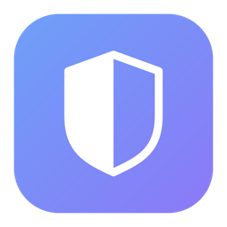

<p align="center">
  
</p>

<h1 align="center">VPNonly</h1>

<p align="center">
  Route <b>only the apps you choose</b> through a WireGuard VPN on macOS.<br>
  Everything else keeps its normal connection.
</p>

<p align="center">
  <a href="https://vpnonly.app">vpnonly.app</a> ·
  <a href="#install">install</a> ·
  <a href="#how-it-works">how it works</a> ·
  <a href="#limitations">limitations</a>
</p>

---

Most VPNs are all or nothing: you connect, and your browser, video calls and
banking all move to another country. This does the opposite. **Nothing is
tunneled unless you ask for it.**

```
  ▗▖  ▗▖▗▄▄▖ ▗▖  ▗▖ ▗▄▖ ▗▖  ▗▖▗▖ ▗▖  ▗▖
  ▐▌  ▐▌▐▌ ▐▌▐▛▚▖▐▌▐▌ ▐▌▐▛▚▖▐▌▐▌  ▝▚▞▘
  ▐▌  ▐▌▐▛▀▘ ▐▌ ▝▜▌▐▌ ▐▌▐▌ ▝▜▌▐▌   ▐▌
   ▝▚▞▘ ▐▌   ▐▌  ▐▌▝▚▄▞▘▐▌  ▐▌▐▙▄▄▖▐▌

  ● connected · utun7 · exit 187.15.103.25
  your address is 182.69.182.133

  CapCut                         ● in VPN
▶ Google Chrome
  Cursor

  ↑↓  |  Enter open  |  D disconnect  |  R refresh  |  Q quit
```

About a thousand lines of shell, a short Python config parser and one small C
file. No kernel extension, no Network Extension entitlement, and your default
route is never touched.

## Install

```sh
brew tap kanishkdan/vpnonly && brew trust kanishkdan/vpnonly && brew install vpnonly
```

Homebrew pulls in WireGuard, compiles the small launcher, and puts `vpnonly` on
your PATH. The `brew trust` step is Homebrew 6's confirmation for third-party
taps, which seems fair for something that asks for root.

Then set up NordVPN, once.

**NordVPN.** For automatic selection and hostname pinning, fetch a key. Generate an access token at
[my.nordaccount.com → Manual configuration → Access token](https://my.nordaccount.com/dashboard/nordvpn/manual-configuration/),
then run `fetch-creds.sh` from the install directory
(`$(brew --prefix)/opt/vpnonly/libexec/fetch-creds.sh`) and paste it in.
Alternatively, NordVPN now offers individual WireGuard configs through its
[manual connection setup](https://support.nordvpn.com/hc/en-us/articles/51499280685457-How-to-set-up-a-manual-NordVPN-connection-on-macOS-using-WireGuard).
These can be supplied directly to `up.sh` or imported into the Mac app.

**Other WireGuard providers: not yet.** The CLI runs the stock `wireguard-go`
from Homebrew, which sends packets into the tunnel with your LAN address as the
inner source. NordVPN's servers accept that; providers that enforce cryptokey
routing (Mullvad, Proton, most self-hosted servers) silently drop it, so the
tunnel comes up but nothing gets through. For now the CLI is NordVPN-only in
practice. `up.sh` will still load another provider's `.conf` if you want to
try yours.

The Mac app bundles a patched `wireguard-go` that rewrites the inner source, so
other providers work there. The CLI catches up when the formula builds the same
patch. Details under *How it works*.

### Pin a NordVPN server

Automatic country selection remains the default. To compare a specific standard
NordVPN WireGuard server, start the CLI with `vpnonly --server us1234` (replace
the example with the server's actual hostname). The full
`us1234.nordvpn.com` form is also accepted. Disconnect the current CLI tunnel
before changing this selection.

The choice is saved in `~/.config/vpnonly/nord-pinned.conf`. Later connections
reuse its fixed IP endpoint and public peer key, including after a restart;
they do not ask the recommendation API for another server. `vpnonly --auto`
explicitly removes the pin and returns to automatic country selection.
The lower-level `up.sh` accepts the same two options.

In the Mac app, choose **Pin NordVPN server…** from the VPN menu. It saves a
separate profile using the existing config picker. Selecting a pin never falls
back to another server if that connection fails. Choose **NordVPN** in the
menu to return to automatic selection; the saved pin remains available.

Both clients resolve the exact hostname against NordVPN's public catalog and
require one online WireGuard server. The initial lookup can take longer than a
country recommendation because it downloads the catalog. Reconnects are local.
No access token or private key is sent by this lookup. Saved `.conf` files contain
your private key: keep them private, including when copying a pin between clients.
A removed server or changed peer key requires an explicit new selection.

The Mac app displays the running peer's endpoint. CLI status labels its saved
values **configured server** and **configured endpoint**: interface existence
alone does not prove a recent handshake or working traffic. Check the exit probe
as well. Pinning enables a more controlled comparison; it is not a speed fix.
Use the same server, endpoint, WireGuard protocol, test destination and time
window when comparing clients. The app and CLI still use different WireGuard
builds and local-network policies, as described below.

### Or from source

```sh
brew install wireguard-go wireguard-tools
git clone https://github.com/kanishkdan/vpnonly && cd vpnonly
./fetch-creds.sh          # NordVPN only
```

You need Xcode Command Line Tools either way, for `cc` to build the small
launcher. macOS offers to install them the first time it's needed.

## Using it

One command does everything:

```sh
vpnonly
```

It asks for your password, because creating a tunnel and firewall rules needs
root. From source, that's `sudo ./vpnonly`.

That shows what's connected and which apps are inside the tunnel. Pick an app
with the arrow keys and press Enter to switch it in or out; turning the first
one on connects the tunnel. `d` disconnects, `r` refreshes, `q` quits.

### The individual commands

`vpnonly` is a front end over these, and they all still work on their own:

```sh
sudo ./up.sh                                  # NordVPN, Singapore by default
sudo COUNTRY=us ./up.sh                       # or pick a country
sudo ./up.sh ~/Downloads/provider.conf        # or a .conf (see Install)

sudo ./run.sh                                 # pick an app from a list
sudo ./status.sh                              # what's routed, and both exit IPs
sudo ./down.sh                                # everything back to normal
```

`up.sh` brings up the tunnel but routes nothing. `run.sh` is what puts an app
inside it, and with no arguments it just asks:

```
$ sudo ./run.sh
Apps on this Mac:
   1  Android Studio
   2  CapCut
   3  ChatGPT
   ...
Pick a number (or q to quit): 2

launched through the tunnel (pid 40317): CapCut
check it with: sudo ./status.sh
```

Or name it directly, if you'd rather not scroll:

```sh
sudo ./run.sh CapCut                          # by name
sudo ./run.sh /Applications/CapCut.app        # by path
sudo ./run.sh /usr/bin/curl https://api.ipify.org   # any binary, with arguments
```

Safari is left out of the list on purpose. See the limitations below.

Bringing it up looks like this:

```
server: sg668.nordvpn.com (103.75.11.42:51820)
interface: utun7
exit IP via tunnel: 187.15.100.99
your normal IP:     223.181.33.133
Tunnel up. Launch an app inside it:  sudo ./run.sh /Applications/YourApp.app
```

Two different addresses is the whole proof. `status.sh` shows the same
comparison at any time, plus which processes are currently in the group.

## How it works

macOS's built-in PF firewall can't match packets by *application*, but it can
match by *unix group*. That's the entire trick.

1. **`up.sh`** starts a userspace WireGuard interface, asking the kernel for a
   free `utunN` rather than claiming a fixed name, and brings it up **without
   installing a default route** so nothing uses it by default. It creates a
   group called `vpnonly` and loads two rules into VPNonly's own PF anchor:

   ```
   pass out quick on ! lo0 route-to (utun7 10.5.0.2) inet proto { tcp udp } \
       from any to any group vpnonly keep state
   block return out quick on ! lo0 from any to any group vpnonly
   ```

   There is deliberately no `nat` rule. macOS evaluates PF translation against
   the interface the OS originally routed to, so a `route-to`'d packet never
   reaches a rule keyed to the tunnel (measured: 0 matches in 32,000
   evaluations), and keying it to `en0` instead makes the translated packet
   leave via `en0`. PF cannot both translate and redirect one packet. The
   inner source is therefore rewritten inside `wireguard-go` in the Mac app
   (`app-engine/wireguard-go-nat.patch`, tests included); the CLI's stock
   `wireguard-go` doesn't yet, see the caveat under *Install*.

   The `block` rule is the kill switch. If the tunnel goes down, group traffic
   is refused rather than leaking to your ISP, and `return` means the app fails
   immediately instead of hanging until it times out. It has to hold across a
   deliberate disconnect too: an app keeps the group until it exits, so while
   any app launched this way is still open, `down.sh` removes only the `pass`
   rule and leaves the `block` in place. The app is held offline until you quit
   it (`vpnonly`'s Turn off quits and reopens it outside the group), and the
   block is cleared once the last one is gone.

2. **`vpnrun`** (a short C file, run via sudo) launches your app with its group
   set to `vpnonly`, then drops privileges back to you. Every helper process
   the app spawns inherits the group, so Chromium-style multi-process apps work.
   It also makes the app responsible for its own privacy prompts, so when a
   routed app asks for the microphone or camera, macOS names the app in the
   dialog rather than blaming the launcher and killing the app outright.

Group membership is fixed when a process starts and can't be changed
afterwards, which is why an app has to be launched through `run.sh` rather than
switched over while it's already open.

**`/etc/pf.conf` is never read, modified or reloaded.** Rules live in a
dedicated anchor under `com.apple/`, which macOS already evaluates, so other
firewall tools keep their rules and VPNonly keeps its own. `down.sh` touches
just that anchor and stops just the process it started.

## Limitations

- **NordVPN only, for now.** Other providers need the patched `wireguard-go`;
  see the caveat under *Install*. The Mac app works with any of them.
- Apple Silicon and Intel both work here; the compiled launcher is built on
  your machine.
- **Safari and other WebKit apps can't be routed.** WebKit hands its
  connections to separate system processes that macOS starts on its own, so
  they never carry the group and PF has nothing to match. Mullvad and Proton
  VPN document the same limitation for their macOS split tunneling. Chrome,
  Firefox, Arc and Brave are fine.
- **DNS queries are not tunneled.** Apps resolve through mDNSResponder, which
  runs outside the group, so lookups still exit over your normal connection
  even though the connections themselves are tunneled. Two consequences. Your
  ISP can still see which hosts you look up. And a geo-aware DNS answer can
  hand an app a local endpoint even though its traffic is leaving through the
  tunnel correctly, so a different exit IP is not on its own a guarantee of
  appearing to be somewhere else. That second one hasn't broken CapCut in
  testing, which appears to gate on the source IP rather than on which edge you
  reach, but that is luck rather than design. Doing it properly needs a DNS
  proxy network extension.
- IPv6 is blocked for grouped apps rather than tunneled. No leak, but no v6.
- No automatic reconnect if the server drops. `down.sh` then `up.sh`.
- Don't run your provider's own app *connected* at the same time. `up.sh`
  checks for this and refuses, because a tunnel inside another tunnel usually
  breaks on MTU.

## Verifying

```sh
curl -s https://api.ipify.org                          # your normal IP
sudo ./run.sh /usr/bin/curl -s https://api.ipify.org   # the VPN exit IP
```

## Roadmap

The architecturally "right" version is a Network Extension
(`NETransparentProxyProvider`) matching flows by the app that made them, which
is how PIA's client does split tunneling on macOS. This repo is the
zero-dependency, auditable version.

## Security notes

- Your WireGuard private key lives in `~/.config/vpnonly/` with mode 600 and
  never leaves the machine. Revoke the Nord access token after use; it's only
  needed once to fetch the key.
- Everything that runs as root is in this repo: `vpnonly` (it re-runs itself
  with sudo), `up.sh`, `down.sh`, `run.sh`, `status.sh`, `parse-wg.py` (called
  by `up.sh`) and `vpnrun.c`. `fetch-creds.sh` runs as you.

## The Mac app

There's also a menu bar app that does this with a list of every app on your
Mac, a country picker, per-app switches (an open app restarts once to join, then
switching is instant), and automatic updates. It's $19 once for two Macs:
[vpnonly.app](https://vpnonly.app). Two-minute demo of the app:
[youtu.be/C9L9OaURekc](https://youtu.be/C9L9OaURekc).

The privileged engine it installs is published in
[`app-engine/`](app-engine/) with a checksum manifest generated by the same
command that builds each release, so you can read exactly what runs as root
before trusting it. The CLI above is the same idea, built separately and
without the menu bar interface.

## Licence

MIT for everything that runs as root: the scripts at the repository root and
everything under [`app-engine/`](app-engine/). Read it, audit it, reuse it.

The compiled app (the `VPNonly-*.zip` releases) and the website under `docs/`
are not MIT. The app is a paid product and redistributing it isn't permitted;
its terms are at [vpnonly.app/terms](https://vpnonly.app/terms.html).
[`LICENSE`](LICENSE) sets out the split in full.

Bundled WireGuard and Sparkle components retain their upstream licences. See
[`app-engine/THIRD-PARTY-NOTICES.txt`](app-engine/THIRD-PARTY-NOTICES.txt).
